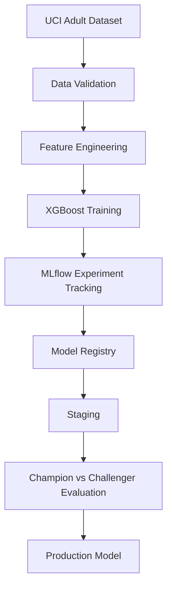
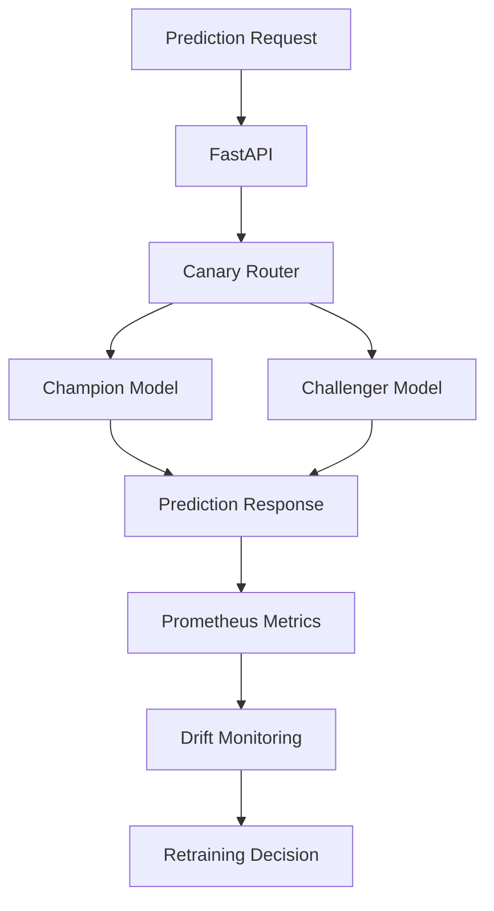

# MLForge — Production ML Lifecycle Platform


**MLForge** is an end-to-end MLOps project demonstrating how to train, track, register, serve, and monitor machine-learning models through a structured lifecycle.

The project uses the UCI Adult Income dataset and an XGBoost classifier, with MLflow for experiment tracking and model registry, FastAPI for model serving, and monitoring components for drift detection and prediction metrics.

## Highlights

- Data ingestion and schema validation
- Feature preprocessing with Scikit-learn
- XGBoost model training and evaluation
- MLflow experiment tracking and model registry
- Champion/challenger model management
- FastAPI prediction endpoints
- Deterministic canary traffic routing
- Feature drift detection using PSI, KS, and chi-squared tests
- Prometheus metrics and Grafana dashboard configuration
- Docker Compose configuration for supporting services

## Model Performance

**Dataset:** UCI Adult Income  
**Samples:** 48,842  
**Validation samples:** 4,885

Latest recorded validation results:

| Metric | Score |
|---|---:|
| ROC-AUC | **0.9287** |
| F1 Score | 0.7211 |
| Accuracy | 0.8796 |
| Precision | 0.8094 |
| Recall | 0.6501 |
| Average Precision | 0.8349 |

Experiments, parameters, metrics, and model artifacts are tracked with MLflow.

*These are validation metrics from the recorded training run, not a guarantee of performance on new data.*

## Architecture

### Training and Model Registry



### Model Serving and Monitoring



## Technology Stack

| Area | Technologies |
|---|---|
| Language | Python 3.11 |
| Data processing | Pandas, NumPy |
| Machine learning | Scikit-learn, XGBoost |
| Experiment tracking | MLflow |
| Model serving | FastAPI, Uvicorn |
| Testing | Pytest |
| Monitoring | Prometheus, Grafana |
| Infrastructure | Docker Compose |

## Project Structure

```text
MLForge/
|
|-- src/
|   |-- data/           # Data loading and validation
|   |-- features/       # Feature preprocessing
|   |-- training/       # Model training and experiment tracking
|   |-- registry/       # Model registration and promotion
|   |-- serving/        # FastAPI and canary routing
|   |-- monitoring/     # Drift detection and retraining logic
|   `-- pipelines/      # Training and retraining pipelines
|
|-- tests/              # Automated tests
|
|-- monitoring/         # Prometheus and Grafana configuration
|
|-- Dockerfile
|-- docker-compose.yml
|-- Makefile
|-- requirements.txt
|-- .env.example
`-- README.md
```

## Getting Started

### 1. Clone the Repository

```bash
git clone https://github.com/khushi-149/MLForge.git
cd MLForge
```

### 2. Create a Virtual Environment

Windows PowerShell:

```powershell
py -3.11 -m venv venv
.\venv\Scripts\Activate.ps1
```

### 3. Install Dependencies

```powershell
python -m pip install -r requirements.txt
```

### 4. Start the MLflow Tracking Server

Open a separate terminal:

```powershell
mlflow server --host 127.0.0.1 --port 5000 --backend-store-uri sqlite:///mlflow.db --default-artifact-root ./mlartifacts
```

### 5. Train the Model

In another terminal, activate the virtual environment:

```powershell
$env:MLFLOW_TRACKING_URI = "http://127.0.0.1:5000"

python -m src.pipelines.train_pipeline --experiment adult-income --output-dir data
```

### 6. Start the API

```powershell
uvicorn src.serving.app:app --host 127.0.0.1 --port 8000
```

### Access the Application

| Service | URL |
|---|---|
| API documentation | http://127.0.0.1:8000/docs |
| Health check | http://127.0.0.1:8000/health |
| Prometheus metrics | http://127.0.0.1:8000/metrics |
| MLflow UI | http://127.0.0.1:5000 |

## API Reference

### POST `/predict`

Accepts a feature dictionary and returns a prediction response.

Example request structure:

```json
{
  "features": {
    "age": 39,
    "workclass": "State-gov",
    "education": "Bachelors"
  },
  "request_id": "550e8400-e29b-41d4-a716-446655440000"
}
```

The feature dictionary must contain all features expected by the trained model.

### Other Endpoints

| Endpoint | Purpose |
|---|---|
| `GET /health` | Service and model health |
| `GET /metrics` | Prometheus metrics |
| `GET /model/info` | Model information |
| `POST /predict/batch` | Batch predictions |

## Drift Detection

MLForge includes statistical approaches to monitor changes in incoming feature distributions.

| Method | Purpose |
|---|---|
| Population Stability Index (PSI) | Quantifies distribution changes |
| Kolmogorov-Smirnov test | Detects numerical distribution differences |
| Chi-squared test | Tests categorical distribution differences |

PSI thresholds are configurable:

| PSI Range | Interpretation |
|---|---|
| Below 0.1 | Low drift |
| 0.1–0.2 | Moderate drift |
| Above 0.2 | Significant drift |

Drift results can be used to inform retraining decisions.

## Configuration

Configuration can be supplied through environment variables or a local `.env` file.

| Variable | Default | Description |
|---|---|---|
| `MLFLOW_TRACKING_URI` | `http://localhost:5000` | MLflow tracking server |
| `MLFLOW_EXPERIMENT_NAME` | `adult-income` | Experiment name |
| `MODEL_NAME` | `adult-income-classifier` | Registered model name |
| `CANARY_TRAFFIC_SPLIT` | `0.1` | Challenger traffic fraction |
| `PSI_THRESHOLD` | `0.2` | Drift threshold |
| `KS_PVALUE_THRESHOLD` | `0.05` | KS significance threshold |
| `API_PORT` | `8000` | API port |

See `.env.example` for the available configuration options.

## Running Tests

With the virtual environment activated:

```powershell
python -m pytest tests/ -v
```

## Docker Compose

A Docker Compose configuration is included for the supporting infrastructure:

- PostgreSQL
- MLflow
- Redis
- FastAPI
- Prometheus
- Grafana

On a machine with Docker Compose installed, start the services using:

```bash
docker compose up --build -d
```

## Future Improvements

- Automated CI/CD pipeline
- Cloud-based model deployment
- More extensive model performance monitoring
- Automated model rollback
- Additional model comparison strategies

## Repository

GitHub: https://github.com/khushi-149/MLForge